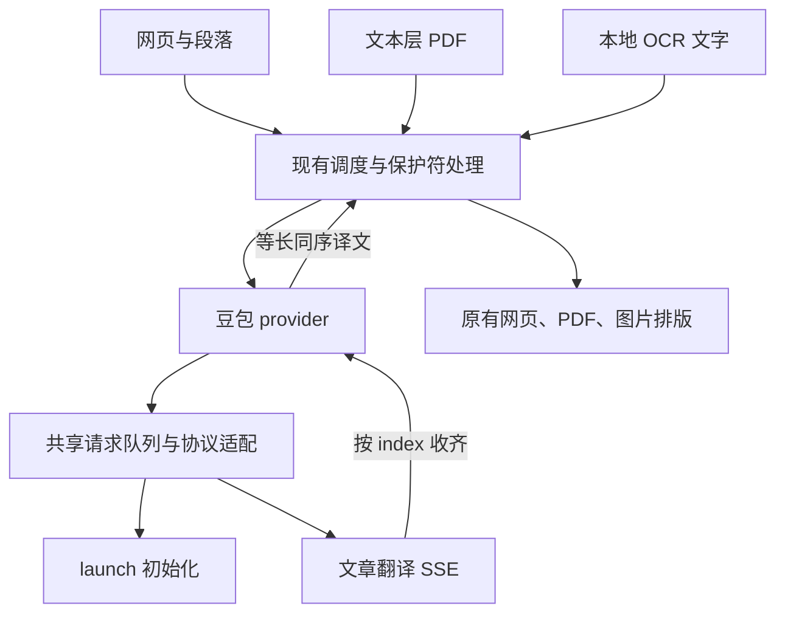

# WuPage 豆包网页登录翻译接入

## 1. 结论与证据范围

**采用独立 `doubao-web` provider：复用用户在同一浏览器中的豆包登录态，调用文章翻译接口，将有序译文交回 WuPage 原有排版链路。**不需要 API Key、本地代理服务或聊天页面自动操作。

初版实验实现和自动化验证已完成。2026-10-27，维护者反馈“翻译正常”，同时报告首次启动失败后需要进入设置手动检测才能恢复。该反馈作为用户实测记录，不等同于开发环境已复现，也没有提供浏览器及版本、语言或完整场景清单；P0 的平台、Origin 对照和恢复矩阵仍需分别验收。

## 本次实现的执行顺序

2026-10-27，仓库维护者要求先按本设计完成实验实现、提交到自己 fork 的 `main` 进行评审和 CI，再打包验证真实账号效果。初版已按此顺序交付，并收到上述正常翻译及首次启动问题的反馈。本次修复继续保留未完成的 P0 真实会话、Origin 对照、平台和效果验收，不把未给出的平台数据标记为已通过。当前采用参考扩展的固定 Origin 兼容模式，尚未确认该模式是否必要。Firefox 豆包入口暂不可用。完整证据与人工测试表见 [验证记录](../doubao-web-verification.md)。

| 材料 | 本次依据 |
| --- | --- |
| WuPage | `SweerItTer/wupage`，`main` 固定提交 `072c08cd9e4b83d9e224aaa662872d8b47e0c796`，package 版本 1.2.0 |
| 主要协议参考 | 用户提供的 `cometix-translate.user.js`，版本 **1.32.7.113**，内嵌构建时间 `2026-10-17T05:32:21.625Z` |
| 扩展机制交叉验证 | `CometixTranslate.zip` 前段可完整校验的 37 项 ZIP，版本 **1.32.7.108**，内嵌构建时间 `2026-10-08T10:43:26.007Z` |
| 作者与原帖 | 用户指定 [Haleclipse](https://github.com/Haleclipse)；[Linux.do 原帖](https://linux.do/t/topic/2910452) |

油猴脚本更新，网页协议以它为主要依据；原生扩展的 DNR 行为由较旧的扩展包佐证。两种运行环境的 Cookie、请求头和流读取能力仍须分别实测。原帖正文未能直接读取，不据此补充附件中没有的能力或授权声明。

## 2. 参考实现如何工作

### 2.1 登录态与两种传输方式

| 运行环境 | 已确认代码行为 | 移植到 WuPage 的含义 |
| --- | --- | --- |
| 浏览器扩展 | 后台 `fetch` 对固定豆包接口使用 `credentials: "include"`；DNR 设置请求 `Origin` | 使用 WuPage 后台请求与已有 DNR 权限 |
| 油猴脚本 | `GM.xmlHttpRequest` / `GM_xmlhttpRequest`，豆包请求使用 `anonymous: false`，由脚本管理器代发并携带可用 Cookie；显式设置同一 `Origin` | 只参考协议，不能把 GM API 直接放进普通扩展 |
| 两者共同点 | 用户在豆包官网正常登录；不让用户填写 API Key，不读取或导出 Cookie 值，不操作聊天框 | 登录交给官网，扩展只发翻译文字与必要客户端参数 |

参考请求的固定来源为：

```text
chrome-extension://dbjibobgilijgolhjdcbdebjhejelffo
```

该 ID 的所属未核实，不能称为“官方授权身份”。它是参考实现里的兼容参数，是否必要由 P0 对照请求确定。Cookie 是浏览器的登录凭证；`web_id` 等设备参数不是登录证明。

### 2.2 网页文章翻译协议

| 阶段 | 请求 | 处理 |
| --- | --- | --- |
| 初始化 | `POST https://www.doubao.com/alice/user/launch` | `Content-Type: application/json`、`Agw-Js-Conv: str`，参考实现无 body |
| 翻译 | `POST https://www.doubao.com/samantha/plugin/stream_article_translate` | JSON body，`Accept: text/event-stream`，读取 SSE |

初始化响应成功后读取 `!!data.config.ttwid`、`data.config.web_id` 和 `data.country`。这些值参与后续查询参数；**launch 成功不等于已登录，更不等于可翻译。**

两类请求使用参考构建中的查询字段：

| 字段 | 值或生成方式 |
| --- | --- |
| `language` / `browser_language` | `zh` / `navigator.language` |
| `device_platform` / `pkg_type` | `web` / `release_version` |
| `aid` / `real_aid` | 均为 `586864` |
| `device_id` | 初始化确认 ttwid 存在时取服务端 web_id，否则 `0` |
| `tea_uuid` / `web_id` | 同一个本地生成的 18 位十进制设备标识；按字符串保存 |
| `is_new_user` | `0` |
| `region` / `sys_region` | 初始化的 country；初始化前为空 |
| `use-olympus-account` / `samantha_web` | 均为 `1` |
| `version` / `pc_version` / `version_code` | `1.38.0` / `1.38.0` / `20800` |
| `web_tab_id` | 后台本次运行生成的 UUID |

这些值来自参考代码，不是公开 API 合约。P0 应记录实际有效值，不猜测更新版本号，也不照搬其他用户的设备标识或会话数据。

请求体示意：

```json
{
  "raw_text": ["Hello world", "Second paragraph"],
  "target_lang": "zh",
  "translate_service": "1"
}
```

- 首版仅接入 `translate_service: "1"`，界面称“豆包（网页登录，实验）”。参考另外提供 `"0"` 和 `"3"`，不在本期增加多引擎菜单。
- 网页接口没有已确认的 `source_lang`、`context`、`model` 或 `systemPrompt` 字段。源语言自动识别；WuPage 的上下文不拼进待翻译文字。
- WuPage 当前的 8 种目标语为 `zh-CN/en/ja/ko/fr/de/es/ru`；`zh-CN → zh`，其余同名传递，逐项实测后启用。
- 参考代码还将 `zh-TW/zh-HK → zh-Hant`。本期不增加繁体选项；别名输入若被接纳，须明确归一化，不能默默转成别的目标语。
- 新油猴脚本另有字幕专用 `/samantha/plugin/translate`：仅 `scene === "subtitle"` 且目标语可映射数字枚举时使用数字目标语言、`source_lang: 0` 和 JSON 响应；否则仍回到文章 SSE。**普通网页仍走上述 SSE。**WuPage 当前没有对应字幕入口，本期不移植该分支。

### 2.3 SSE 完成与索引契约

下面是依据代码重建的协议示意，不是本次线上抓包：

```text
event: json
data: {"code":0,"data":{"items":[{"index":1,"res":"第二段","detect_lang":"en"}]}}

event: json
data: {"code":0,"data":{"items":[{"index":0,"res":"你好，世界","detect_lang":"en"}]}}

event: done
data: {}
```

参考解析器识别 `json / err / done`，按 `items[index]` 回填。每项是一段结果，不能按 token 增量拼接，也不能按接收顺序追加到数组。若 `detect_lang` 与目标语相同，参考实现保留对应原文。

新实现的约束：

1. 使用流式 UTF-8 解码，处理跨网络块的字符、CRLF、事件空行和多条 `data:`；忽略注释/心跳，不将其计作译文。
2. 文章事件的顶层 `code` 必须为数字 `0`，`data.items` 为数组；`index` 必须为当前批次范围内的整数，`res` 必须为可用字符串。同索引同内容重复可忽略；冲突重复、越界或类型错误报协议错误，不能覆盖其他原文。
3. `done` 或正常 EOF 为一次流结束；全部索引齐全才成功。参考允许没有 `done` 的正常 EOF，不能强行改成只有 `[DONE]` 才完成。
4. 缺项只补发缺失子集一次，并保存“子集索引 → 原请求索引”映射；仍缺项则整批失败。半截结果不写成功缓存。
5. `err`、非零业务码、异常断流、HTML 验证页、空输出分别报错；不以返回原文伪装翻译成功。
6. 限制解码前响应累计大小，初值 1 MB；不将服务端整段错误正文、Cookie、完整带设备参数 URL 放入日志。

## 3. 可复现步骤与 P0 退出条件

### 3.1 先验证作者脚本

1. 在同一个浏览器资料目录中安装用户提供的 1.32.7.113 脚本，在豆包官网正常登录。
2. 选择“豆包翻译”，翻译仅含两段普通英文的测试网页；先确认两段都能得到译文。
3. 检查脚本管理器后台的请求，记录 launch、文章翻译、实际 Origin、HTTP 状态和 SSE 结构。GM 请求不一定出现在网页自己的 Network 面板。
4. 登出后重试、重新登录后重试；记录错误码和恢复行为。请求内容只用固定测试句，不保存 Cookie 值或未脱敏 HAR。
5. 记录浏览器、脚本管理器、脚本版本、测试时间。脚本成功只证明该运行环境可用，不能替代 WuPage 扩展验证。

### 3.2 再验证 WuPage 后台

1. 在固定仓库基线上做最小诊断入口，按第 2.2 节生成本机设备参数，先 launch，再发送固定两段文本。
2. 对照 **WuPage 自身 Origin** 与参考固定 Origin：原生可用就不增加改写；只有参考模式实测必需且可用时才启用第 5.2 节的受限兼容层。记录结果，不做运行时无限轮换。
3. 检查同一 profile 的 Cookie 能否随请求到达；关闭豆包标签页再测，验证是否确实不依赖常驻页面。
4. 覆盖 1/2/10 项、重复原文、短文/长段、8 种目标语、乱序结果、同语种、登录退出、网络失败与请求受限。
5. 分别验证 Chrome、Edge；Firefox 独立测试。补测第三方 Cookie 阻止、扩展重载及后台休眠后的恢复。
6. 将脱敏结果写入 `docs/doubao-web-verification.md`，固定可用的 endpoint/参数/Origin 模式、支持语言、长度边界与浏览器矩阵；用合成数据制作解析测试夹具。

**P0 通过条件：**Chrome 和 Edge 各完成真实登录后的两段翻译与登出/恢复；确认可用 Origin 模式、SSE 索引和语言表；排除对作者会话或凭据的依赖。未达到时，标记阻塞原因，停止发布豆包功能；不能把静态代码还原写成“接入成功”。

## 4. WuPage 的接入入口



| 需求 | 现有入口 | 本次处理 |
| --- | --- | --- |
| 设置界面 | `options.html`；`src/options/index.ts:204–323,608–674` | 新增专用表单及读取分支，避免落入 HTTP Template 表单 |
| 弹窗 / 悬浮球 | `src/popup/index.ts:43–51`；`src/content/floating.ts:579–591` | 服务列表已自动生成；补登录状态和操作提示 |
| 网页原文 | `src/content/dom.ts:415–469` | 保留文本提取、节点 ID、原文备份 |
| 全文 / 段落请求 | `page-translation.ts:268–303`；`floating.ts:1198–1211` | 继续 `TRANSLATE_BATCH`，保护符与原索引不变 |
| provider 工厂 / 契约 | `src/background/providers.ts:96–111`；`src/shared/types.ts:188–193` | 注册新类型，返回 `Promise<string[]>` |
| 调度 / 缓存 | `src/background/translation.ts:24–94,324–351` | 豆包原生数组直通；保留统一缓存和校验 |
| 原文恢复 / 显示模式 | `src/content/dom.ts:472–579,850–901`；`styles.ts` | 复用原有双语、双色和替换模式 |
| 代码 / 保护符 | `dom.ts:1521–1634`；`shared/protected-text.ts`；`background/protected-translation.ts` | 原代码节点留在本地，校验 ID 并复用修复路径 |
| PDF | `src/pdf/model.ts`；`index.ts:890–908`；`math.ts`；`layout.ts` | 文字走统一 provider；公式、目录页码和布局留在现有管线 |
| 图片 | `src/background/image-translation.ts:44–55`；`src/content/image-text-layout.ts` | 本地 OCR 后只发文字，沿用识别坐标与覆盖层 |
| 宣传网站 | `.github/workflows/sync-web.yml:38–43` 指向 `mr-wuliu/wupage-web` | 网站页面不在本仓库，接入不需要修改它 |

以上路径和行号固定于第 1 节的提交。WuPage 采用 TypeScript、Vite 和原生 DOM，无需新增前端框架或服务器。[W1–W5]

## 5. 实现设计

### 5.1 配置、工厂与调用语义

新增 `DoubaoWebConfig`，加入 `ProviderType / ProviderConfig`。首版只需现有基础字段和固定 `type: "doubao-web"`；不存 API Key、Cookie、账号密码、可编辑 endpoint 或 Origin。

- `defaults.ts` 加一个可选内置服务，保留当前默认 Google 和用户既有 `activeProviderId`。
- `settings.ts:isProviderConfig` 接纳新类型；旧设置通过现有 `mergeProviders` 自动补项。保存/读取保留启停状态、自定义服务和已有密钥。
- `providers.ts:createProvider` 显式分发，不能落到 HTTP Template。
- `translation.ts:translateProviderTexts` 在保护符处理后，让豆包直接收到 `texts[]`，跳过 `buildContextualSource`。不把豆包加入 `isLlmProvider`。
- 在 `translateWithSettings` 计算缓存键之前生成豆包有效请求：`sourceLang: "auto"`，移除不发送的 `context`。持久设置保留用户原源语言；设置、弹窗、悬浮球和 PDF 控件均显示“源语言自动识别”，不把该值写回全局配置。未知目标语言在发请求前明确拒绝。
- 空批次直接返回空数组；有效文本不得少返回、换序、截断或把多个输入合成一个结果。

建议新建 `src/background/doubao.ts`（provider、队列、初始化、错误）和 `doubao-sse.ts`（纯解析器），确需 Origin 兼容时再新建 `doubao-compatibility.ts`。复用现有保护与调度，不新增通用插件框架。

### 5.2 Cookie、Origin 与生命周期

WuPage 已有 `declarativeNetRequestWithHostAccess` 与 HTTP/HTTPS host 权限。本方案不读取 Cookie 值，不新增 `cookies` 或 `scripting` 权限。[W6][B1]

- 网络只能由后台向 `www.doubao.com` 上第 2.2 节的两个固定 HTTPS endpoint 发出；`credentials: "include"`，`redirect: "error"`。内容脚本不能传任意 URL、Origin 或请求头。
- 初始化状态和 Promise 放在模块级，多实例共享一次初始化。持久化的只有本机随机设备标识；会话状态、服务端设备配置与 web_tab_id 在重启后重建。
- 普通首次翻译自动初始化，无需先在设置中检测。launch 仅遇网络瞬断 / 5xx 时可有限重试，消耗第 5.3 节同一额外尝试预算；重试失败或其他错误明确传播，不吞掉失败后继续发送文章请求。鉴权或服务拒绝后废弃旧会话，拒绝旧队列；用户新发起的翻译或检测可共享一次新的 launch，并以完整文章结果验证恢复。
- 兼容层参考仓库 `ollama-compatibility.ts` 的串行规则变更、引用计数与 `finally` 释放。[W7]
- 豆包规则使用独立范围，例如 `110000–110015`；精确 HTTPS 域名与路径、允许查询参数、POST、XHR，以及 `initiatorDomains: [new URL(chrome.runtime.getURL("/")).hostname]`。
- 只在请求及其响应流仍在使用时持有规则；最终释放。启动清理只处理豆包自己的规则，不能删除 Ollama 的 `100000–104999`。
- 规则安装失败则返回可操作错误，不继续发送需要兼容头的请求。自身 Origin 已通过 P0 时完全不安装规则。

Cookie 设置与浏览器资料隔离仍会影响实际携带；不得通过复制 Cookie 修补跨浏览器登录。[B1] Session 规则可跨 worker 休眠存活，模块内存会丢失，因此启动回收与重新初始化都要验收。[B2][B3]

### 5.3 共享排队、分块、重试和超时

队列必须位于豆包共享层，覆盖网页、段落、PDF、OCR、检测和 `TEST_PROVIDER`。后者当前直接调用 provider，绕过 `translateWithSettings`。[W8]

以下为**初版工程限制**，不是服务端额度；P0 只能据实缩小，放宽需另有测试证据。

| 项目 | 初值 |
| --- | --- |
| 豆包总网络并发 | 1，同一 profile 的所有入口共用 |
| 相邻请求开始间隔 | 至少 1000 ms；含初始化、补发和检测 |
| 一次文章请求 | 最多 10 项，总文本最多 2000 个 JS UTF-16 code unit |
| 请求首响应 / 连续无数据 | 分别 25 秒 / 20 秒 |
| 单个物理请求总时长 | 60 秒，包含完整响应体读取 |
| 一次后台翻译任务总时长 | 110 秒，包含排队、launch、分片、重试及保护符修复 |
| 响应体 | 最大 1 MB |

现有 `groupTexts` 不会拆分单个超长段落，不能把 `chunkSize` 当硬上限。[W3] 豆包适配器应独立拆分超长项：优先句末与空白边界，不切开 UTF-16 代理对或 `⟪WUPAGEn⟫`；保存原输入索引、片段次序和边界空白，译后重组为一项。无自然边界时按 Unicode 字符边界切分；保护标记本身无法容纳则明确失败。拆分前后的源文本必须能精确拼回；纯保护符、空白和分隔片段在本地保留，不发网络。可译片段全部完成后才重组，并对原段执行保护符校验，不能用原文补齐失败片段。拆分可能减弱跨句上下文，不能宣传语义无损。

一次逻辑调用（初始化、初次文章请求及其补发）最多增加一次网络尝试：launch 或文章请求的网络瞬断 / 5xx 可退避重试，正常流结束缺项可补发缺失子集，三者共享一次额外请求预算，不能相乘。多个调用共享 launch 时，共同等待其结果；不能为每个等待者分别增加初始化重试。鉴权、403、429、验证码/拒绝、未知协议、超时和取消不自动重试原任务。429 或限流业务码设置共享冷却时间，默认 60 秒；有合法 `Retry-After` 时至少等待该值。拒绝并释放已排队普通任务，冷却结束不自动重放，由用户重新发起翻译。

从一次 `TRANSLATE_BATCH` 进入后台起建立 110 秒绝对 deadline；`TEST_PROVIDER` 使用同一预算包装。将内部 AbortSignal 传过并发等待、provider、分片和保护修复回调。deadline 到达后移除未发送的等待项、终止当前流并释放持有资源，不能让前台已失败的任务继续发子请求。现 PDF 整页等待上限为 120 秒（`src/pdf/index.ts:47`），后台预算须先结束；无需为此新增前台取消消息协议。

沿用已有保护符修复；它只修复内容结构错误，不能将豆包鉴权/限流/协议错误包装成 `TranslationResponseError` 后触发拆段重试。

超时必须包住 `fetch + reader.read + SSE finish`；现 `fetchWithTimeout` 在响应头返回后就清定时器，不能原样复用。[W9] 结束时释放 reader、计时器、并发槽和 DNR 引用。worker 意外终止后的请求报失败，下一次可重新初始化；不承诺 Promise 能让 worker 永不退出。[B3]

### 5.4 检测状态与错误

“重新检测”是可选的连接诊断，发送固定短文，例如英文 `Hello world` 到中文；不使用页面内容，不读翻译缓存。普通翻译无需先检测，完整的网络文章翻译成功也更新 `ready` 和最近验证时间。只有实际网络翻译完整成功才能显示“可以翻译”；launch 成功、纯空白 / 纯保护符的本地返回以及缓存命中均不能证明当前登录有效。`validateConfig` 只做同步本地配置检查，不承担登录判定。

| 分类 | 证据 / 条件 | 对用户的动作 |
| --- | --- | --- |
| `login-required` | 参考业务码 `710012000 / 710012001 / 710022013`，P0 核对后启用映射 | 打开豆包登录，再直接重试翻译；重新检测作为诊断选项 |
| `rate-limited` | HTTP 429；参考忙码 `710012007 / 676010003` | 显示冷却，手动重试 |
| `service-rejected` | HTTP 403，或参考拒绝码 `710022002 / 710022004` | 提示服务拒绝；必要时去豆包网页检查，不默认称登录过期 |
| `permission-required` | host/DNR 权限不可用或规则安装失败 | 提示检查扩展站点访问权限 |
| `network-error / timeout` | 连接失败、首响应/闲置/总时长超时 | 保留原文，允许重试 |
| `protocol-changed / incomplete` | HTML、未知业务结构、冲突索引、缺项、损坏流 | 不缓存，停止该批，提供脱敏诊断 |
| `unsupported-browser / language` | 平台或目标语未通过能力检查 | 明确提示，用户可主动换服务 |

认证或服务拒绝时，使当前任务失败、废弃会话并释放已经等待的普通任务，停止前台继续派发该轮内容。后续新发起的翻译与手动检测都可以准备新的会话，不再保留“只有设置检测能解锁”的永久阻断。并发的新请求共享初始化，仍遵守串行、间隔、限流冷却和总 deadline；完整网络翻译成功后更新可用状态，旧任务不自动重放。若新请求再次收到鉴权或拒绝，仍立即失败并提示用户处理，不自动反复发送正文或转发到其他服务。

`RuntimeResponse` 保留原 `error` 文本，增加可选 `errorCode / retryAfterMs`；`shared/messaging.ts` 和网页使用的 `content/runtime.ts` 均保留字段，`page-translation.ts` 的状态保留必要错误码及冷却截止时间，供悬浮球决定按钮。连接状态含最近验证时间，来自实际翻译或检测，仅表示最近结果，不能持久保存“永远已登录”。较早任务的完成不能覆盖较新的失败；服务切换后丢弃旧检测结果，避免贴到新服务上。

本期沿用“停止页面翻译 → 恢复原文、停止前台继续提交任务、忽略迟到结果”。已经提交到后台的任务及其分片在上述 deadline 内收尾，不宣称停止按钮立即中断所有后台网络，不新增端到端取消协议。

### 5.5 格式与缓存

“无损接入”限定为**不降低 WuPage 已有的原文、索引、代码、公式和布局保护能力**。

- 原始 DOM 和节点备份留在内容层；provider 不重建网页，不将服务返回值直接赋给 `innerHTML`。
- 保留 `preservePlaceholders → translateProtectedText → normalizeProtectedText`：校验保护 ID 多重集，允许语序变化，不猜补缺失 ID。单段修复仍失败时复用只翻译正文片段、在本地插回保护符的既有回退。[W10]
- 不照搬 Cometix 的 `<bN>` 格式协议。WuPage 普通段落当前也不是所有 `a/em/strong` 标签的完整往返转换，不能把这次接入宣传为新增任意 HTML 无损能力。
- 代码只翻译已识别注释，保留程序文本与行号；PDF 保留公式图像、目录点线和页码；OCR 保留原区域坐标，豆包不接收原图。
- 按现有缓存键保留 provider、原文、目标语和有效配置区分；豆包有效源语言为 `auto`，未发送的 context 不进入其缓存身份，附加固定协议版本及引擎 `"1"`，协议变化时失效。缓存命中不等于会话仍有效。
- 只有完整有序且保护校验通过的结果进入缓存；保留已完成批次，不将失败批次的半截结果或错误页面写入缓存。

## 6. 验证与阶段交付

| 阶段 | 交付与通过条件 |
| --- | --- |
| P0 协议验证 | 第 3 节的脱敏复现记录、实际 Origin 模式、语言和浏览器矩阵；失败明确阻塞 |
| P1 豆包适配器 | 初始化、Cookie 请求、SSE、共享队列、超时和条件 DNR 的单元测试；不依赖真实账号的自动测试 |
| P2 配置与 UI | 设置迁移、专用表单、检测状态、结构化错误、原生数组接入、缓存版本；用户无需填写密钥 |
| P3 保真回归 | 网页/段落/动态 DOM、三显示模式、代码、PDF、OCR、超长项重组均通过 |
| P4 发布准备 | Chrome/Edge 真实联调与现有服务回归，Firefox 单列结论，来源致谢与隐私说明完成 |

`task.json` 给出任务依赖和逐项产物。任务状态随实现和验证更新；静态分析与 mock 测试不抵扣在线验证。执行顺序按第 1 节维护者要求调整。

实现阶段先运行定向测试；集成后运行仓库既有 `npm run typecheck`、`npm test`、`npm run build`、`npm run build:firefox`。按改动范围复用 `test:page / test:floating / test:settings / test:github-code / test:pdf-scope / test:ocr`。在线豆包测试由测试者在浏览器中正常登录，账号和 Cookie 不进入自动化夹具。

## 7. 署名、来源与实现归属

本接入的思路与协议参考应署名 **[Haleclipse](https://github.com/Haleclipse)**，来源为 **[CometixTranslate 的 Linux.do 原帖](https://linux.do/t/topic/2910452)** 和用户提供的扩展、油猴脚本。WuPage 的现有架构与版权声明继续保留。

后续实现必须在 README 致谢、豆包适配器文件头、实现说明和 PR 描述中保留上述作者与两条链接。建议表述：

> 豆包网页登录翻译的接入思路与协议参考 Haleclipse 的 CometixTranslate。感谢其提供的实现参考。作者：https://github.com/Haleclipse；来源：https://linux.do/t/topic/2910452。本项目按 WuPage 架构独立实现适配。

附件含第三方依赖许可证，未据此确认整个 CometixTranslate 的源码授权；署名也不替代授权。按观测到的协议独立实现，若直接复用原代码，需另确认对应许可并保留声明。本交付不包含参考脚本或打包代码的复制品。

## 8. 证据索引

### 8.1 附件身份与源码定位

| 材料 | SHA-256 |
| --- | --- |
| 新油猴脚本 | `e4816e578aeedfa0c4fb1171f8ae107ef7af0d5fc2716c62f4caa2e3eeda758b` |
| 用户原 ZIP | `bb06abc3d31c5663d4f5541d8f72d52c4855cd485ec5b737f09471e58728a3c5` |
| ZIP 前 4,118,742 字节的自洽归档 | `f20fb7708655ece634e933bdf64dc6476292f3361afe8c796a48027d54f15094` |
| 前段 background.js | `4aa22fc295f684e690c703b35ed3a2d6fec7e30af4a3acc2cae5011e83045848` |

原 ZIP 含两个中央目录及 EOCD，末尾目录指向另一套布局，标准解压报错。前段 37 项经标准 ZIP CRC 检查全部通过；残留两份字幕脚本不参与旧扩展分析。该校验只证明归档内部自洽，不证明作者原件或新版完整性。新油猴脚本是本次更完整、更新的协议依据。

压缩代码优先按唯一锚点搜索；行号只适用于上表哈希对应文件。主要证据均在 `cometix-translate.user.js`：

| 行为 | 行号 / 唯一锚点 |
| --- | --- |
| GM 携带登录态及设置来源 | 2322；`async function SQ(`、`anonymous:!n`、`Origin:I3`；豆包白名单命中时 n=true |
| 固定 Origin、接口及参数白名单 | 2322；`I3="chrome-extension`、`R3=[`、`M3=(t,e)=>` |
| 设备参数与 launch | 3432；`async function aY(`、`async function J4e(`、`async function _y(` |
| 文章/字幕请求体分流 | 3433；`case"doubao-web":{`、`e.scene==="subtitle"?P3` |
| 文章语言 / 字幕数字枚举 | 2427 `Qse=`；2317 `function P3(` |
| SSE 事件、索引和完成 | 2317–2322；`function F3(` |
| SSE 读取与缺项补发 | 3443；`var oEe=2`、`async function iEe(` |
| 字幕 JSON 与顺序取 res | 2317 `function O3(`；3443 `async function rEe(` |

旧扩展补充证据：

| 行为 | background.js 行 / 锚点 |
| --- | --- |
| Cookie 与 Origin 白名单 | 第 11 行；`async function DA(`、`bf="chrome-extension` |
| DNR 规则 | 第 11 行；`function QA(`，UTF-8 字节偏移 61,580 |
| 参数 / 初始化 | 第 847 行；`async function Mk(`、`async function $z(`、`async function Lk(` |
| 文章请求体 | 第 848 行；`case"doubao-web":{` |
| SSE 与缺项补发 | 第 6 行 `function IA(`；第 858 行 `var s3=2`、`async function a3(` |
| 打开官网 | options.js 第 18 行；`function os()` |

### 8.2 仓库及平台依据

- **W1** [类型与 provider 契约](https://github.com/SweerItTer/wupage/blob/072c08cd9e4b83d9e224aaa662872d8b47e0c796/src/shared/types.ts)
- **W2** [provider 工厂](https://github.com/SweerItTer/wupage/blob/072c08cd9e4b83d9e224aaa662872d8b47e0c796/src/background/providers.ts#L96)
- **W3** [翻译调度、分块、上下文与缓存](https://github.com/SweerItTer/wupage/blob/072c08cd9e4b83d9e224aaa662872d8b47e0c796/src/background/translation.ts)
- **W4** [DOM 提取、渲染和原文恢复](https://github.com/SweerItTer/wupage/blob/072c08cd9e4b83d9e224aaa662872d8b47e0c796/src/content/dom.ts)
- **W5** [开发结构与测试命令](https://github.com/SweerItTer/wupage/blob/072c08cd9e4b83d9e224aaa662872d8b47e0c796/docs/development.md)
- **W6** [Manifest 权限](https://github.com/SweerItTer/wupage/blob/072c08cd9e4b83d9e224aaa662872d8b47e0c796/public/manifest.json)
- **W7** [现有 Ollama DNR 生命周期](https://github.com/SweerItTer/wupage/blob/072c08cd9e4b83d9e224aaa662872d8b47e0c796/src/background/ollama-compatibility.ts)
- **W8** [后台消息与 TEST_PROVIDER 旁路](https://github.com/SweerItTer/wupage/blob/072c08cd9e4b83d9e224aaa662872d8b47e0c796/src/background/index.ts#L78)
- **W9** [现有超时包装器](https://github.com/SweerItTer/wupage/blob/072c08cd9e4b83d9e224aaa662872d8b47e0c796/src/background/providers.ts#L586)
- **W10** [保护符校验与正文回退](https://github.com/SweerItTer/wupage/blob/072c08cd9e4b83d9e224aaa662872d8b47e0c796/src/background/protected-translation.ts)
- **B1** [Chrome：Storage and cookies](https://developer.chrome.com/docs/extensions/develop/concepts/storage-and-cookies)
- **B2** [Chrome：declarativeNetRequest](https://developer.chrome.com/docs/extensions/reference/api/declarativeNetRequest)
- **B3** [Chrome：Service worker lifecycle](https://developer.chrome.com/docs/extensions/develop/concepts/service-workers/lifecycle)
- **B4** [Tampermonkey：GM_xmlhttpRequest](https://www.tampermonkey.net/documentation.php?locale=en&q=GM_xmlhttpRequest)

平台文档说明浏览器能力和限制，不是豆包私有接口的可用性证明。
